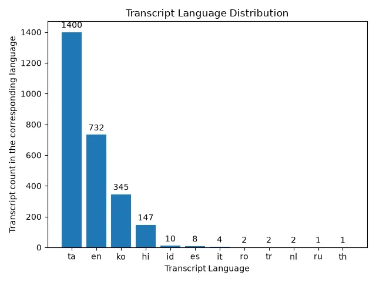

### SBUS comments
SBUS is a tamil tech enthusiast youtuber. He read and reply comments(mostly asking guidance or a detailed review of the product they have been using) of his subscribers and members of the channel in videos but as there are almost more than 2000+ videos uploaded in the channel, and would increase day by day. It became impossible to find when and where SBUS has replied to the comment/query/guidance asked by the user. This project aims to solve this problem. Channel Link - [link](https://www.youtube.com/@Sivabharani)
- scraped transcripts are from the videos on or before `June 14 2026`

- There are auto generated transcript for each video, so i will scrape all the available transcripts
- and do processing to segregrate timestraps of each video where he says a person name.
- user can simply search their name and it will list all the youtube video with the exact timestamp of the name being read, which would most likely be while reading that user's comment.

## Transcription Language Distribution
As all the transcript of these video are autogenerated, there is not a uniform distribution of the generated transcript language. the below bar chart demonstrates it.

## Findings
- The english transcripts are just worthless. you can see it only recognizing 2-3 words in a whole sentences, missing every details. i found this by inspecting few video having english transcripts.
- When i tried to convert the auto generated ko (Korean) transcript to ta (Tamil) transcript, i got `The requested language is not translatable` from the youtube transcript api. i think this is because korean transcript is already auto generated, and not manually created. so i think trying to translate this transcript is the issue. i am not sure tho.
- There are 1185665 transcript chunks to be processed individually to reduce the hallucinations .
- Since there are this much transcript chunks, i cannot just slap on a search onto this transcript data.

## Method: commenter readout by prompting
SBUS reads a commenter's name/handle aloud right before reading their comment, in a small set of cue patterns found by watching videos and verified against all 1.18M chunks:

- `name + ப்ரோ`, bare `name`, `name + என்ன சொல்லிருக்காரு/சொல்லிருக்காங்க/சொல்லிருக்கான்`, `name + வந்திருக்காது`, `name + அப்படிங்கற/அப்படிங்கிற நண்பர் வந்து`, `name + என்ன கேட்டுருந்தாரு`, compound English usernames in Tamil script (`டார்க் ஹன்டர்` -> `darkhunter`)
- the cue word is `நண்பர்` (ண); `நம்பர்` (ம) means phone number and is never a handle
- spoken English usernames are captioned in Tamil script, and `சொல்லிருக்காரு`-type cues are written fused (no spaces), so the prompt lists transcript spellings, not spoken spellings

The canonical prompt is `prompt-templates.md`. Each notebook embeds its own copy; `build_pilot_v5_nb.py` asserts at build time that the embedded prompt matches the template.

## Eval
- `processing_notebook/eval_handles.jsonl` - 17 hand-labeled regression windows (+/-2 chunks) across 4 videos, with `silver` labels
- `processing_notebook/eval_cue3.jsonl` - 30 hand-labeled `சொல்லிருக்காரு`/`சொல்லிருக்காங்க` windows (15+15, 30 distinct videos), built by `make_cue3_eval.py`
- `processing_notebook/pilot-handles-v5.kaggle.ipynb` - v5 prompt on all 47 rows (`unsloth/gemma-3-4b-it`), reports combined plus reg/cue3 split metrics to `shards/pilot_handles_v5_metrics.json`. Target: beat v4 (`9 exact / 8 eng / 1 clean_empty / 2 leak` on the 17)
- older pilots (`pilot-handles-v2`, qwen challenger, bench) and their metrics stay in `shards/` as history
